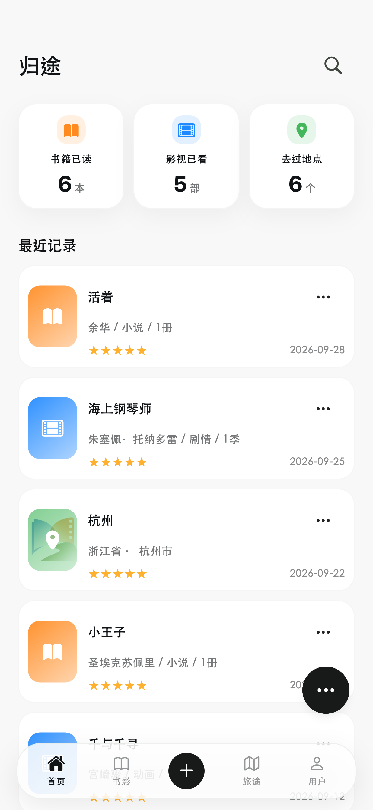
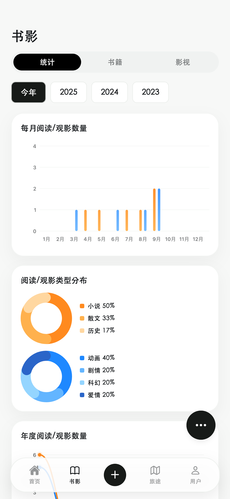
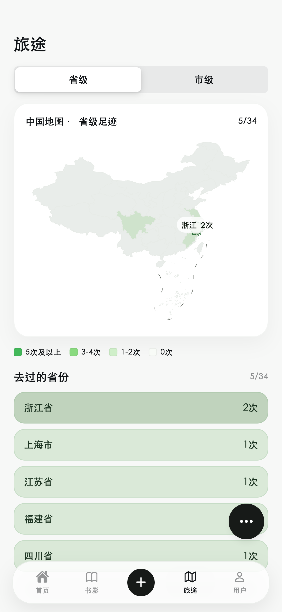
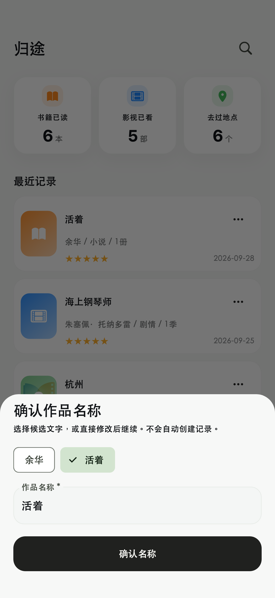
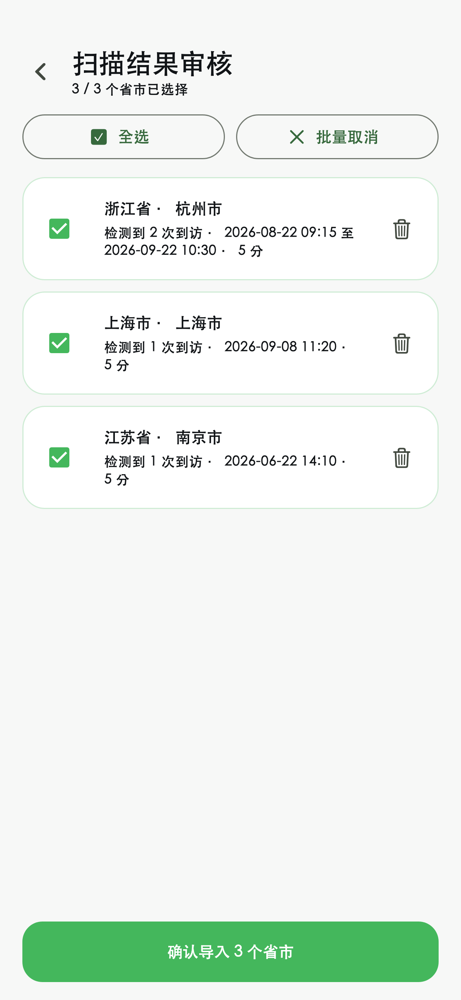
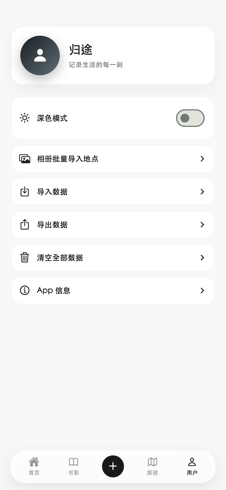

<p align="center">
  
</p>

<h1 align="center">归途</h1>
<p align="center"><b>读过的书，看过的电影，走过的地方。</b><br>把生活，慢慢归档。</p>
<p align="center">免费开源的 Android 生活记录 App · 不登录 · 无广告 · 本地保存</p>

<p align="center">
  <a href="https://github.com/SySH-7/guitu/releases/download/v0.3.1/guitu-v0.3.1-android-signed.apk"></a>
  <a href="LICENSE"></a>
</p>
<p align="center">
  <a href="https://github.com/SySH-7/guitu/releases/tag/v0.3.1">版本说明</a> ·
  <a href="#界面预览">界面预览</a> ·
  <a href="#开始使用">开始使用</a> ·
  <a href="https://github.com/SySH-7/guitu/issues">反馈与建议</a>
</p>

## 0.3.1，让记录少一点手动输入

归途将阅读、影视和旅途放在同一个本地档案里。用评分和备注留下感受，再通过书影统计与省级 / 市级足迹地图回顾自己的生活。

| 新版功能 | 怎么用 |
| --- | --- |
| **拍封面，少打一遍名字** | 首页、书影或旅途页右下角打开快捷入口 → 拍照或选择封面 → 本地识别文字 → 确认作品名 → 预填阅读 / 影视表单。其他字段由你填写。 |
| **到了就记，省市帮你填** | 快捷入口选择当前位置 → 主动授权定位 → 预填省市与时间 → 补充记录后保存。 |
| **旧照片，也能找回旅途** | 用户页 → 相册批量导入地点 → 授权扫描 → 审核省市、到访日期和评分 → 确认导入。照片需要包含可用的 GPS 与拍摄时间。 |

连续多天停留在同一省市会整理为一次到访；间隔至少七天，或中途到过其他地点，才计为下一次到访。首页地点数量按省市去重，旅途列表可以联动选中地图区域。

完整变更见 [v0.3.1 更新说明](RELEASE_NOTES_v0.3.1.md) 和 [更新日志](CHANGELOG.md)。

## 界面预览

下图使用 **0.3.1 原始 Flutter 界面与演示数据**生成，展示真实组件布局。设备响应由截图环境提供演示输入；相机、定位和照片权限以 Android 设备实际授权为准。截图说明见 [来源与生成方式](docs/screenshots/v0.3.1/README.md)。

| 首页与最近记录 | 书影统计 | 省级足迹 |
| :---: | :---: | :---: |
|  |  |  |

| 作品名确认 | 相册结果审核 | 用户与数据管理 |
| :---: | :---: | :---: |
|  |  |  |

## 开始使用

1. [下载 Android v0.3.1 APK](https://github.com/SySH-7/guitu/releases/download/v0.3.1/guitu-v0.3.1-android-signed.apk)，或进入 [Release 页面](https://github.com/SySH-7/guitu/releases/tag/v0.3.1) 选择同名安装包。
2. 安装并打开归途，无需注册账号。
3. 底部 **＋** 手动新增阅读、影视或地点；右下角快捷入口用于封面识别与当前位置录入。
4. 想补记过去的旅行，进入 **用户 → 相册批量导入地点**。想备份，使用 **用户 → 导出数据** 保存 JSON。

公开安装包已内置省级 / 市级足迹地图。当前公开安装版本为 **Android**。

### 从旧版升级

早期 `0.2.1` 调试签名 APK 无法直接覆盖安装正式签名版本。已保存记录的用户应先在旧版导出 JSON 并确认文件保存成功，再卸载旧版、安装正式签名版，最后导入备份。已使用相同正式签名的版本可正常覆盖升级；具体以设备安装结果为准。

0.3.1 兼容已有阅读、影视、地点、头像与深色模式数据；旧数据中的用户名字段会被忽略，应用内展示名固定为“归途”。

## 功能与数据

- **集中记录**：书籍、影视、地点，保存日期、评分、备注等信息。
- **回顾与统计**：首页概览、月度 / 年度书影图表、类型分布、省级 / 市级足迹地图。
- **快捷录入**：本地封面 OCR 确认作品名、当前位置省市预填、相册历史旅途审核导入。
- **主题与备份**：浅色 / 深色模式，JSON 导出与导入。
- **本地优先**：不要求注册，不包含广告、行为追踪或远程统计服务；记录默认保存在 Android 应用私有目录。

OCR 在本机处理，封面图片不上传；相册扫描读取授权范围内照片的必要元数据，不复制或上传原始照片。扫描结果确认前不会写入旅途。相机、照片和定位权限由用户主动授予；Android 14+ 的部分照片授权会限制扫描范围。

## 支持与反馈

如果归途对你有用，欢迎在仓库右上角点一颗 **Star**，支持后续更新。也欢迎通过 [Issues](https://github.com/SySH-7/guitu/issues) 反馈问题或提出建议；报告问题时附上应用版本、Android 版本和复现步骤，方便定位。

<details>
<summary><b>开发与本地运行</b></summary>

### 技术栈

Flutter / Dart、Material 与 Cupertino 组件、CustomPainter 图表与足迹地图、MethodChannel Android 文件 / OCR / 定位 / 照片元数据能力、Flutter Test。

### 环境与运行

Flutter 3.24 或兼容版本、Dart 3.5 或兼容版本、Android SDK 和模拟器 / 设备。

```bash
flutter pub get
flutter doctor
flutter run
```

公开源码不包含第三方地图 GeoJSON。缺少地图数据时，旅途页显示“地图数据未配置”；阅读、影视、统计与 JSON 导入导出仍可使用。需要本地行政区边界数据的省市匹配功能也依赖兼容地图数据。配置说明见 [assets/data/README.md](assets/data/README.md)。

### 验证与构建

```bash
flutter analyze
flutter test
flutter build apk --debug
```

APK 输出位于 `build/app/outputs/flutter-apk/`。正式签名构建需在本机配置 `android/key.properties` 和私有 keystore。

### 目录

```text
lib/
├─ main.dart            # 入口、主题、全局装配
├─ shell.dart           # 导航、新增与快捷入口
├─ models/              # 记录与行政区模型
├─ screens/             # 首页、书影、旅途、用户
├─ services/            # 存储、设备能力与本地省市匹配
├─ ui/                  # 表单、OCR 流程、相册审核、图表与地图
└─ widgets/             # 通用组件

docs/screenshots/       # 界面预览与来源说明
test/                   # Widget 与数据测试
android/                # 原生 Android 工程
```

</details>

<details>
<summary><b>地图与第三方数据说明</b></summary>

出于第三方数据授权与地图合规考虑，公开源码仓库不包含 `china_provinces.geojson` 和 `china_cities.geojson`。发布安装包可在不公开源数据文件的前提下内置地图数据，用于保证应用内省级/市级足迹地图正常展示。本地私有开发时可自行在 `assets/data/` 中配置兼容的 GeoJSON，相关说明见 [THIRD_PARTY_NOTICES.md](THIRD_PARTY_NOTICES.md)。

本项目属于个人技术展示作品，不是官方地图产品，也不提供导航、定位、测绘或互联网地图服务。应用内足迹地图仅用于个人记录中的行政区划可视化统计，不作为行政边界认定或完整标准地图使用。源码仓库中的地图绘制代码只做屏幕适配所需的等比例渲染、填色和交互，不修改原始地图数据文件。公开传播地图数据、二次发布含地图的构建或商业使用前，使用者应自行确认地图审核、数据授权和其他合规要求。

市级足迹地图优先使用天地图市级行政区划面数据。对于数据源中未提供独立市级面的直辖市、港澳台及部分省直管或特殊县级区域，应用使用同源省级行政区划面作为可视化兜底，以避免足迹区域空缺。

</details>

## 后续计划

- 探索自接 API 的 AI 功能。
- 持续优化功能展示与使用体验。

以上为后续方向，尚不属于当前 Android 0.3.1 的功能。

## 开源许可

除第三方地图数据外，项目代码采用 [MIT License](LICENSE) 开源。
