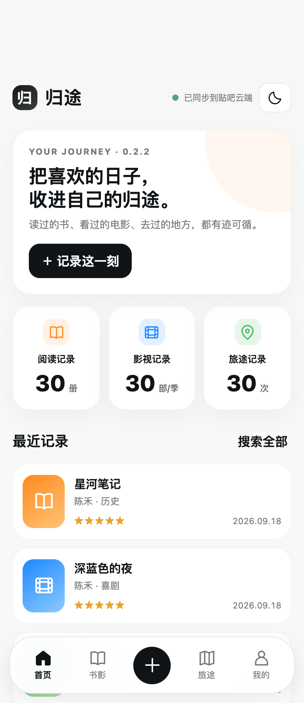
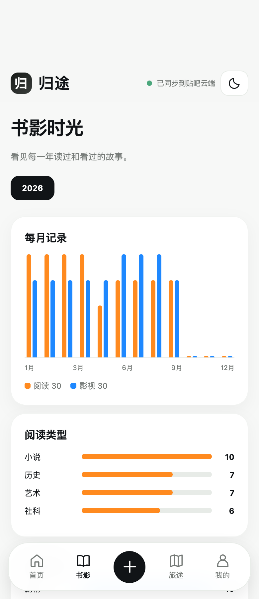
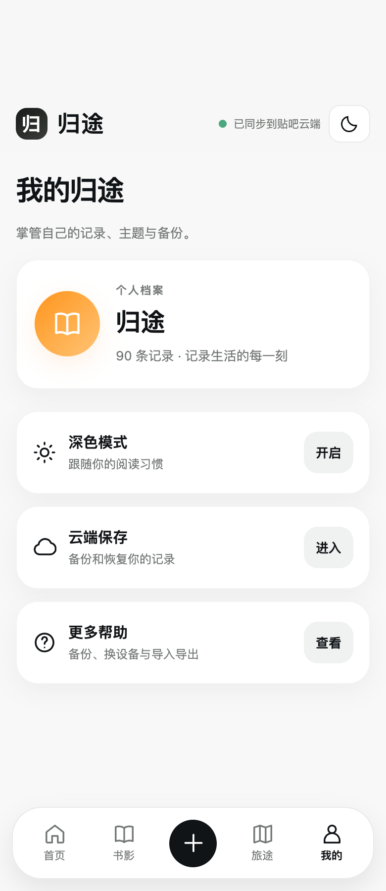

# 归途 · 百度贴吧 H5 版

**读过的书，看过的电影，走过的地方，把生活慢慢归档。**

归途的百度贴吧小应用适配版，使用 HTML、CSS 和原生 JavaScript 实现，构建为可上传至贴吧开放平台的单个 HTML 文件。

本分支为 `tieba-h5`；[Android 版源码和下载入口在 main 分支](https://github.com/SySH-7/guitu/tree/main)。H5 基于 Android **0.2.2** 的功能与备份格式重建，视觉参考 **0.3.1**，不包含安卓新版的拍照识别、相册导入等功能。

## 当前状态

- **已通过百度贴吧小应用审核**（开发者于 2026-10-20 确认）。审核通过不等同于已发布上线；本仓库暂不提供正式上线入口。
- 对应平台版本：`v179215220644`。业务源码与该版本的本地留档一致；生产地图配置、私有城市坐标缓存及含这些内容的构建产物不公开。
- [版本对应与源码校验](docs/version-reference.json) · [验证范围和已知限制](docs/verification.md)

## 界面预览

截图使用虚构数据与模拟平台服务，仅展示界面，不代表真实云端操作结果。

<p>
  
  
  
</p>

## 已有功能

- **书籍与影视**：名称、作者或导演、分类、日期、数量与评分；按年份查看数量和类型统计。
- **旅途足迹**：按省市记录地点，百度地图展示城市指针；地图独立手势开关、查看全图与页面间实例复用。
- **记录管理**：搜索、编辑、删除；按日期倒序，首次 10 条，点击查看更多再追加 10 条。
- **本机备份**：复制备份文本、粘贴导入；格式验证后合并，同 ID 本机内容优先。
- **贴吧云端保存**：手动保存、查看摘要、下载合并、删除当前应用云存档；默认压缩和容量检查，读取失败时停止覆盖或删除。
- **主题与布局**：深色模式、移动端安全区、窄屏与长标题适配。

书影名称限 60 字，作者/导演限 30 字。每周成功保存最多 5 次属于应用侧提醒与约束，并非不可绕过的服务端配额。上传前显示数据大小、第三方托管提醒与五秒确认。

## 本地构建

需要 Python 3.9+。构建使用的压缩库已内嵌，不需要下载运行时依赖：

```bash
git clone --branch tieba-h5 --single-branch https://github.com/SySH-7/guitu.git
cd guitu
python3 build.py
```

输出为 `dist/guitu-tieba-0.2.2.html`。可先在浏览器查看界面；完整的身份和云存档功能需要部署到自己的贴吧小应用，普通网页预览无法替代贴吧 App 验收。

### 配置地图与平台

```bash
BAIDU_MAP_AK='你自己的浏览器端地图 AK' python3 build.py
```

将生成的 HTML 上传至[贴吧开放平台](https://tieba.baidu.com/home/aiapps/home)，按[官方接入文档](https://tieba.baidu.com/home/aiapps/openH5Intro)配置并在贴吧 App 预览。SDK 由平台注入，不在普通网页中擅自模拟真实云端权限。

浏览器端 AK 会随网页发送，不能当作服务端秘密；请在百度地图控制台为自己的部署域名设置 Referer 限制。本分支不提供项目生产 AK。未配置 AK 时仍可使用记录与备份功能，地图会提示配置未就绪。

`src/city-points.json` 为 `{}` 占位文件，保留既有百度在线地址解析兜底；省会中心点仍可直接使用，其他城市首次定位依赖网络与地图权限。若有可合法使用的城市中心点缓存，可按 `{"省份|城市":[经度,纬度]}` 格式私下填入后重建。具体边界见 [第三方说明](THIRD_PARTY_NOTICES.md)。

### 虚构数据预览

```bash
GUITU_INCLUDE_SAMPLES=1 python3 build.py
```

生成独立的 `dist/guitu-tieba-0.2.2-preview.html`，首次打开合并 90 条虚构记录，不自动上传云端。勿把带样例的预览文件当成正式包提交。跨 1999–2026 年的 200 条测试备份另见 `test/final-varied-archive.json`，导入后可观察分页和统计。

## 测试

需要 Node.js 22+；核心单元测试无需第三方 Node 依赖：

```bash
npm test
```

浏览器测试使用 Playwright，所有云端读写由测试替身拦截，不操作真实用户存档：

```bash
npm ci
npx playwright install chromium webkit
python3 build.py
npm run test:smoke
npm run test:cloud
npm run test:guard
npm run test:varied
```

Linux 系统可使用 `npx playwright install --with-deps chromium webkit` 安装浏览器所需依赖。若复用系统 Chrome，可设置 `GUITU_CHROMIUM_EXECUTABLE` 为其可执行文件路径。

`test:guard` 会从百度官方域名下载并校验指定 SDK，仅用于本地隔离测试，不上传 SDK 源码。若官方内容改变而校验失败，应先核对新 SDK，再明确更新固定校验值。CI 自动检查构建、单元测试和模拟云端烟雾流程。

## 数据与使用边界

- 本机数据保存在网页浏览器存储中。清理 App 数据、换设备或改变网页来源可能导致记录无法读取，请自行备份。SDK 没有返回用户 ID 时只按当前会话临时保存。
- 云端是贴吧小应用存档，不是百度网盘。保存不会删除本机数据；下载会合并记录；删除仅移除当前应用存档中的归途记录，不承诺抹除平台日志或历史备份。
- 单次上传按编码后的整份载荷限制为 **30,000 字节**。这是应用的保守限制，不是百度公布的存储配额；超限会拒绝上传，不截断本机数据。
- 云端读取保护依赖当前官方 SDK 的请求及返回格式；平台变更时可能暂停云端操作，需要核对后适配。本机记录和手动备份不依赖该云端服务。
- 当前版本没有第三方自动内容审核服务，不应把免责声明或字数限制视为审核能力。请勿上传私人敏感信息或违规内容。
- 源码、测试和文档由开发者与 AI 协作完成，主要功能经本地回归和贴吧端验收；自动化模拟不代表所有设备、网络和账号权限均已验证。

## 目录

```text
src/                   页面模板、样式、业务逻辑和基础省市目录
vendor/                内嵌 pako 及许可证
test/                  单元测试、模拟平台测试和虚构数据
scripts/               测试 SDK 下载与校验
docs/                  界面截图、版本对应和验证说明
build.py               单 HTML 构建
```

项目自有代码使用 [MIT License](LICENSE)。百度地图、贴吧 SDK 和外部数据的使用条件分别适用，不包含在本项目的授权中。问题反馈请使用 [GitHub Issues](https://github.com/SySH-7/guitu/issues)，注明“贴吧 H5 版”。
